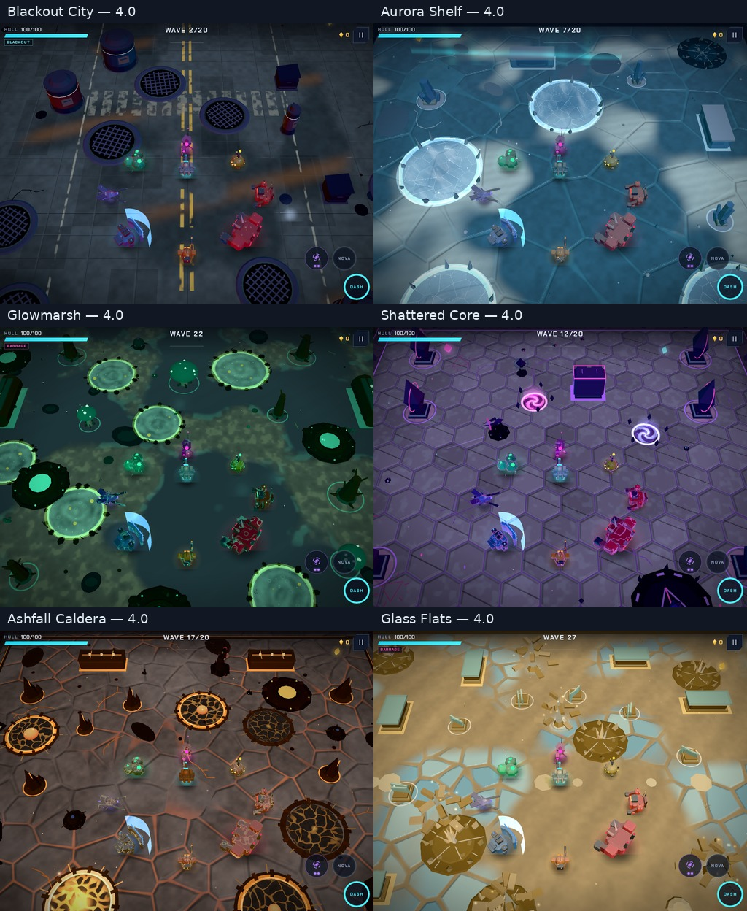
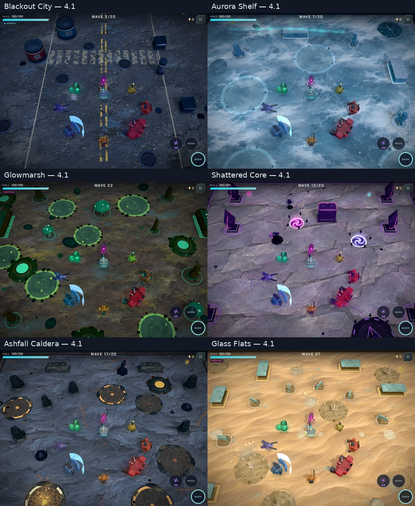

# 4.1 — painted worlds, equipment and physical sound

The 4.0 geometry audit established spatial correctness, but the screenshots still read as prototype art.
The owner identified the new painted ground as the direction for the rest of the game, then expanded the
brief to cover characters, weapons, effects and a more realistic sound foundation. This is the applied brief
and a record of rendered game captures, resource cost and validation.

## Applied improvement prompt

> Build a coherent painted game at its normal camera distance. Give every biome a distinct material floor,
> grounded scenery and readable lighting. Carry that detail through the walker, enemies, bosses, weapons,
> effects and equipment panels, adapting steel, armor, hide, wood and crystal to their roles. Keep active
> warnings clear and preserve collision footprints, seeded layouts, saves and touch controls. Check complete
> transformed scenery geometry, especially exterior volcanoes at every Caldera edge and corner.
>
> Rebuild combat sound and place accents around physical recordings and damped material bodies, with distinct
> weapon mechanisms, impacts, movement and warnings. Keep spatial cues, protected warning voices and bounded
> memory. Revoice the score with softer acoustic partials while retaining its arrangements and timing.
>
> Make High detail standard. Replace Auto/Saver with a 30/60/120 FPS limit, defaulting to 60, with no detail loss
> when lowering the cap. Inspect actual game pixels, exercise touch and offline play, measure the added costs,
> and do a final check before opening the PR.

## Visible changes

| World | Material and map work |
|---|---|
| Blackout City | Painted wet asphalt and worn road paint, smaller physical sewer covers, weathered metal and neutral moonlit fill. Electrical warnings retain the full damage radius. |
| Aurora Shelf | Painted stress fractures and snow, layered ice materials, softer patch boundaries and low rim chips. |
| Glowmarsh | Painted peat, moss and shallow water pockets, textured wood, clearer neutral lighting and quieter bloom-water surfaces. |
| Shattered Core | Painted fractured violet stone, physical carved monolith ribs and small glowing glyphs. |
| Ashfall Caldera | Closed sculpted strata, irregular cooled vent rims, fine molten fissures and restrained warning swells. Exterior volcanoes, pipes and fumaroles use cooled stone rather than flat brown. Black ash-disc clutter is removed. |
| Glass Flats | Painted wind-rippled sand, glass fragments, textured sandstone and translucent flared dust ribbons. |

All 25 enemy types get role-preserving painted finishes and a more restrained palette and halo. Bosses use
material-specific surfaces. The walker has overlapping chest/shoulder armor over a darker frame. Its weapons
have metal barrel collars, dark bores, vents and distinct coil, disc, tank and rail details. Static weapon
parts batch by material while the turret and walking joints remain animated.

Combat uses bounded soft smoke, material sparks and chips, physical rocket casings and metal discs/blades.
Ordinary deaths no longer cover the floor in broad colored light; bosses retain their stronger signatures.
Projectile halos and muzzle lighting are quieter. Unlit attack glows, hit flashes and danger outlines stay clear.
Menus use worn charcoal panels, painted teal/brass buttons and warm metal lettering, retaining rarity accents.

A small baked contact mask grounds solid obstacles. One 1024 × 1024 directional shadow map covers physical
scenery and actors; exterior backdrops and glow cards do not cast across the arena. Every FPS setting keeps
these surfaces, shadows and the full particle budget. FPS changes do not recreate the renderer or alter the
fixed simulation step. Legacy graphics settings migrate to the new default.

## Sound rebuild

The old SFX recipe chains and place-accent recipes are replaced by a recorded/physical voice module. A single
22,050 Hz mono PCM bank holds 19 short source regions. Seven weapons combine distinct reports/mechanisms with
damped inharmonic bodies, air and grain; deaths, hits and footsteps use material families. Warning bodies rise
without the former arcade pitch sweeps. The existing spatial routing, priority allocator, music ducking and
limiter remain authoritative. Weather, water, birds, insects, frogs and distant mammal calls have separate
noise/resonance models, so wildlife does not borrow a metal or gun transient. City engines, rotors, horns,
sirens and radio/buzz accents also use dedicated excitation models.

The bank loads once and is precached for offline play. Decoded recordings are shared across contexts; prepared
voices reuse a 48-entry LRU cache. A procedural physical fallback can sound immediately while recordings load.
Ended live sources disconnect. Score arrangements remain; softer acoustic partials replace the harsher waveform
palette. The new bank is part of the audio-test cache key.

[Recording credits and pinned source/license links](../public/audio/SOURCES.md) ·
[Rebuild manifest](../tools/audio-sources.json) · [Asset builder](../tools/build-audio-bank.py)

[Before sound](review-4.1/audio-before.mp3) · [After sound](review-4.1/audio-after.mp3)

The matched isolated reel uses game-engine output, the same effect volume and no room processing. Order: Pulse,
Scattergun, Arc Caster, Railgun, Rocket Pod, Disc Launcher, Ember Jet, hit, armor death, organic death, glass death,
heavy wind-up, beam warning. Each segment is 1.3 seconds. It is a listening reference; numerical checks establish
technical correctness rather than subjective sound approval.

## Artwork and resource cost

Both atlases were generated for this pass with OpenAI ImageGen, then encoded to WebP without retouching their
composition. Original PNGs remain in the session's generated-images output.

| Shipped asset | Resolution/format | Bytes |
|---|---|---:|
| [Terrain atlas](../public/textures/terrain-atlas.webp) | 1536 × 1024 WebP; six biomes | 301,598 |
| [Surface atlas](../public/textures/surface-atlas.webp) | 1536 × 1024 WebP; steel, armor, chitin, rubber, bark, quartz | 402,230 |
| [Physical sound bank](../public/audio/physical-bank.wav) | Mono 22,050 Hz / 16-bit PCM, 6.35 seconds | 279,928 |

The media adds about 961 KiB. The two atlases occupy approximately 12 MiB of RGBA GPU texture data; the decoded
bank is about 1.1 MiB at 44.1 kHz, plus bounded prepared voices. Smoke has a 128² procedural alpha texture and a
48-instance cap, adding one draw call only while active. Physical rockets share an instance pool. Surface detail
keeps the existing batches and enemy geometry budget; small transient debris retains its cheaper material.

Four shifted floor samples blend tile interiors without mirrored repetition. With the atlas ready the floor
bypasses the older procedural cells; physical surfaces use three triplanar samples. High's shadow target and pass
have a measurable cost. A lower FPS cap reduces submitted frames rather than removing detail. No physical-device
FPS or thermal claim is made by these software-rendered captures.

## Game captures

The character/weapon plates are staged views; weapon panels crop the central portion of the rendered frame.
The overview comparison uses the same staged layout, actor kit and camera. Decorative particles vary, and models
and scenery have intentionally changed. These are rendered frames with labels and contact-sheet assembly only.

Before, 4.0:

After, 4.1:

[City](review-4.1/city.jpg) · [Caldera](review-4.1/caldera.jpg) ·
[Caldera centre, edges and corners](review-4.1/caldera-edges.jpg) · [Phone, High at 30 FPS](review-4.1/phone.jpg)

[Characters](review-4.1/characters.jpg) · [Weapons/effects](review-4.1/weapons.jpg) · [Bosses](review-4.1/bosses.jpg) ·
[Home](review-4.1/home.jpg) · [Workshop](review-4.1/workshop.jpg) · [Phone upgrade cards](review-4.1/upgrades.jpg) ·
[FPS controls](review-4.1/fps.jpg)

## Validation

- `npm run check`: **47/47 checks pass** in 56.1 seconds, including formatting, lint, build, save migration, pacing and
  **252 real map layouts**. Geometry checks cover complete transformed triangles, collision footprints,
  arena edges, all director modes, animated extrema and exterior scenery. Closed rock stays within its authored
  envelope, and the enemy kit stays within its 810-triangle budget.
- `npm run test:render`: **5/5 browser flows pass with actual drawing** in 251.5 seconds, covering tablet/phone multitouch,
  onboarding and audio recovery, training/archive progress, offline continuation and worker updates.
- **48 biome scenes**, six matched overviews and nine additional Caldera centre/edge/corner views render
  without browser or shader errors. The final images above were inspected, including the phone layouts.
- The equipment check renders **seven weapons and all 25 enemy types**, compiles smoke/rocket programs,
  exercises all three FPS choices and checks High shadows and 44-pixel phone FPS buttons. Ten additional
  tablet/phone interface views cover home, settings, workshop, pause and upgrade cards; cards fit the viewport.
- Full audio health passes **361 sound cases, 18 music renders and 36 budget cases** in 254.8 seconds, including decoded
  recordings, finite samples, tails, stereo, continuous fire, flooding and scheduling. Live unlock, background,
  fault and recovery checks also pass. The before/after reel is provided for listening; no subjective listening
  judgment is inferred from signal measurements.
- Dependencies are current at review time: Playwright **1.65.0**, Prettier **3.10.0** and Three.js **0.187.0**;
  `npm outdated` reports no available updates. The routine and actual-drawing gates are rerun on Chromium 158
  after the development-tool updates; the comparison captures were made with Chromium 156.

Staged encounter cost with High detail (shadow submissions included):

| Biome | Tablet 60-cap calls / triangles | Phone 30-cap calls / triangles |
|---|---:|---:|
| Blackout City | 99 / 47,036 | 98 / 46,974 |
| Aurora Shelf | 139 / 30,898 | 139 / 30,908 |
| Glowmarsh | 118 / 74,644 | 115 / 73,862 |
| Shattered Core | 146 / 30,506 | 136 / 29,836 |
| Ashfall Caldera | 109 / 56,754 | 109 / 56,724 |
| Glass Flats | 145 / 35,016 | 142 / 34,968 |

These are single staged frame counts, not measured frame rates. Camera aspect and transient particles account
for layout differences. [All tablet metrics](review-4.1/60fps-metrics.csv) ·
[All phone metrics](review-4.1/30fps-metrics.csv). The main minified bundle is about 25 KiB smaller than the 4.0
baseline after replacing the old audio recipe chains; media and rendering costs are reported separately above.

The all-biome review caught duplicate biome-shader definitions on shared boss materials. Composition is now
idempotent and covered by a regression; the visual tool stops at the first browser/shader error with its scene.
The worker fixture also observes registration/controller state synchronously, without hiding lifecycle events
behind asynchronous identity messages. No routine test timeout was raised. Browser flows wait for the painted
atlases and first frame, and require the recording bank to decode after offline continuation.

Physical-device heat, speaker balance and a natural full-run art/listening review remain useful manual checks.
