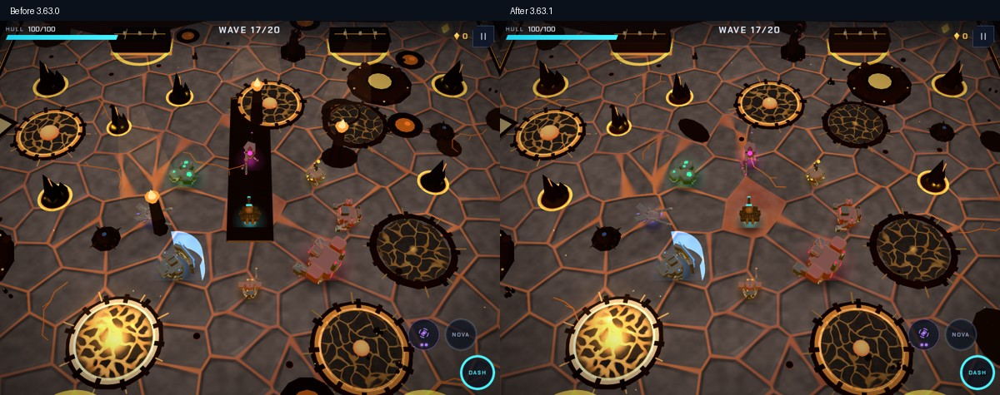
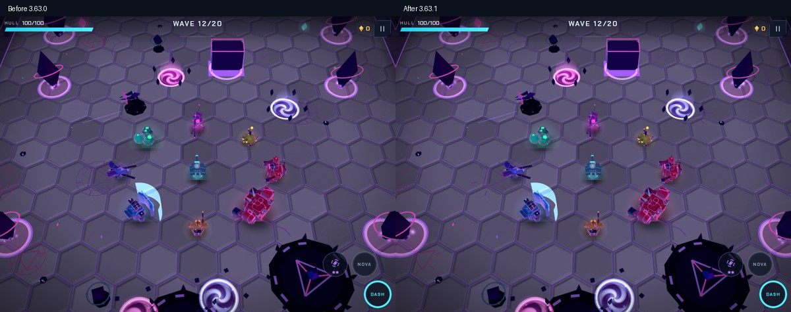

# Biome readability review — 3.63.1

Base: `f9eea5c`, merged 3.63.0. Review branch: `fix/biome-readability-3.63.1`.
The review started with the black object crossing the centre of Ashfall Caldera.

## Findings and changes

| Finding | Evidence and resolution |
|---|---|
| Black runway through the centre | `calderaDetail` added a fixed 2.4 × 10.6 ground box at z = −2.2, with two glowing end strips. It had no collision and covered the new material. Removed the obsolete decorative channel. |
| Walk-through fire pillars in combat | Three fixed 2.6 m pillars, flames and tall heat plumes occupied interior coordinates independent of collision. Moved them beyond the rampart using current arena dimensions. |
| Harmless molten pools resemble hazards | Seven decorative ponds used the same hot visual vocabulary as active vents. They now sit outside the boundary. Real vent/attack warnings remain inside. |
| Rocks collect at map origin | Pond rocks used offsets such as x = r × 0.55 without the pond position. They now use p.x/p.z. The new spawn-clearing regression fails with the old coordinates and passes after correction for three seeds. |
| Vertical ridges have stunted decoration | The old vertical branch used narrow depth D for the long spine, cross-seam spacing and vent spacing. A local-axis builder now rotates the complete decorated ridge with its collision footprint. For an 8 × 2 ridge, vents span 4.16 m rather than 1.04 m. A mesh-bounds rotation regression covers this. |
| Basalt reads as black cut-outs | Raised the three Caldera rock material values while retaining the dark volcanic palette. This is a readability adjustment, not a physics change. |
| Decorative Core circles look actionable | Removed closed rings from floor runes; their broken angular etchings remain. Active portals and circular warnings retain the closed-ring vocabulary. This is a visual-design decision, not a simulation defect. |

Before images come from a separate checkout/build of the published 3.63.0 source. Both versions
use the same fixed layout, camera and fully settled obstacle positions; actor invulnerability flash
is disabled for the capture. Scenes are arranged through the debug interface, not naturally played fights.

## Wider review

| Biome | Source/image review |
|---|---|
| Blackout City | Street props and wet markings checked; active manhole hazards are distinct from low ground clutter. No additional confirmed placement defect in reviewed scenes. |
| Aurora Shelf | Ice sheets and bright rims are actual traction features. Reviewed against red attack warnings; kept their gameplay meaning. |
| Glowmarsh | Ordinary dark puddles/low vegetation differ from active bright acid pools. Reviewed ground clutter and props; no additional confirmed defect in sampled scenes. |
| Shattered Core | Kept the crown beyond the north barrier and active portals; simplified misleading decorative rings. |
| Ashfall Caldera | Corrected the fixed interior channel/pillars, false hazard decoration, origin rocks, ridge axis and rock values. |
| Glass Flats | Reviewed glass-obstacle silhouettes and moving Dust Devils. Their collision/hazard meaning is retained. |

Coverage: six biomes × encounter/boss/warnings on tablet High; Caldera phone Saver; another Caldera
layout on phone High; final Caldera/ Core captures; an explicitly arranged horizontal/vertical ridge
pair on phone Saver. These are bounded samples, not exhaustive layouts or every boss attack phase.

## Verification

- Standard gate: 32 tests, including the two new geometry/placement regressions.
- Optional drawing gameplay gate: five flows passed (158.2 s).
- Staged drawing matrices: no browser/shader errors; the phone fixture also checks boss-HUD placement.
- The origin-placement regression was run with the original bad expression and failed, then passed after restoring the fix.
- No simulation, collision, sound, input or save format was changed. Final CI status is linked in the PR.

Environment: Chromium 156, SwiftShader, desktop touch emulation, 1024 × 768 tablet and 844 × 390
landscape phone. Physical-device comfort, thermal performance and unsampled layouts remain acceptance work.
