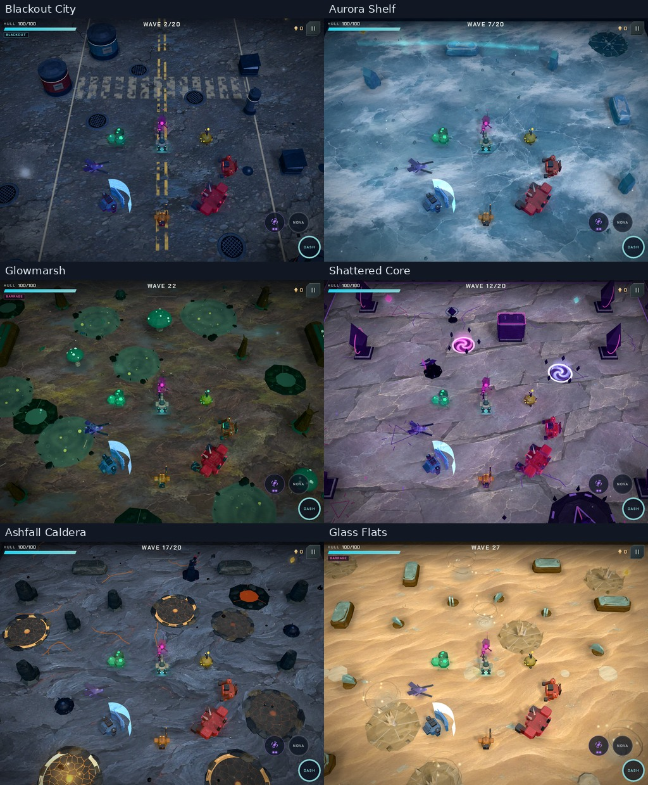

# 4.1.1 — repository checkup, connected walker and biome cleanup

This follow-up reviews the merged 4.1 release and addresses the owner's reports of an unattached gun,
unfinished models, stray biome geometry and glass-like enemy hits. It also checks whether the repository's
current dependencies, tools, documentation and offline build are still needed and working.

**What changed**

- Rebuilt the player with a beveled armored chassis, inset sensor, exposed joints, articulated leg armor and
  grounded feet. The gun sits on a physical ball-and-ring bearing beneath the chassis hierarchy. Its aim
  compensates for body turning, lean and walking sway; recoil moves the gun within its cradle. Muzzle effects
  follow each weapon's real barrel tip. Rigid body parts batch by material while joints retain their motion.
- Removed decorative obstacle-foot rings, raised frost/puddle/decal discs, duplicate pedestals in natural
  biomes, Caldera beacons, illuminated post caps, ridge studs, flat lava strips, decorative lava ponds and solid
  ash-puff stacks. Fractured ice, broken glass, eroded sandstone and cooled basalt replace the remaining
  block/table-shaped scenery. Reed paint
  composes with its existing wind shader. Mushroom and wood finishes match their surfaces.
- Peat and basalt jet traps now have broken natural banks, darker liquid mouths and restrained fissures in
  place of collars, button faces and lamp studs. Their existing warning and eruption animation is retained.
- Permanent ice and bloom-water patches blend into the terrain with irregular softened shores. Repeated
  circular light rims and evenly spaced bank lumps are removed. Gameplay telegraphs retain their damage
  radii; map collision, damage, timing, seeds and progression rules are preserved.
- Damage events carry target identity into normal/critical impact sound and particles. Armor, organic,
  stone, energy and crystal targets have distinct short voices; ordinary armor/flesh hits use damped, filtered
  transients. Direct crystal hits use glass. Shields use the energy impact. Critical hits retain their material
  identity. Sniper/beacon, heavy-robot and carrier deaths use fitting material families. Hit flashes preserve
  the underlying finish instead of washing the entire enemy flat white.
- Fixed stale startup diagnostic controls and an outdated save fixture. Browser flows now fail on health-check
  failures. Settings changes retain the drawing buffer. Removed retired graphics tiers, unused floor uniforms,
  the old mouse-projection helper and unused browser wrappers. Development watches public assets and package
  metadata, including atomic replacement, and serializes rebuilds.
- Refreshed current audio/pacing documentation, capture paths, release metadata and recording-credit references.
  Existing painted atlases and the 19-recording bank are reused; no new generated game assets are added.

**What was checked**

- `npm run check`: formatting, lint, build and all **51 tests passed in 57.9 seconds**. The five functional
  browser flows cover tablet play, phone multitouch, first-run tutorial/audio/backgrounding, training/archive
  isolation and service-worker updates. The tablet flow also checks startup health and verifies that changing
  settings does not reset the drawing buffer.
- The complete transformed-face map audit passed **252 layouts** across all six biomes, every authored map
  template and all 12 director modes, multiple seeds and arena sizes. It checks more than one million triangle
  faces, exterior placement, collision footprints, animated extrema and wind bounds. Caldera ridge rotation,
  spawn clearance and whole-prop exterior placement have separate regressions.
- The player passed **1,344 combined body-facing, aim and walking/banking/dash configurations across all seven
  weapons**. Attachment
  pivots coincide, aim stays horizontal and independent of the body, recoil remains local and muzzle positions
  stay finite. All seven complete player kits remain below 3,000 triangles including the shield; enemy kits
  remain within their 810-triangle budget.
- Rendered **48 biome scenes**: encounters, bosses, warnings and telegraphs in every biome on landscape tablet
  with a 60 FPS cap and phone with a 30 FPS cap, with High detail, loaded atlases and shadows enabled. Added six overviews,
  nine Caldera centre/edge/corner views and six ready/warning/eruption views for the two reworked jet traps.
  Equipment review covers seven weapons, all 25 enemy types, eight player-turn poses, smoke/rocket effects and
  the 30/60/120 FPS controls. Captures report no browser or shader errors; scene counts are not hardware FPS
  measurements.
- The full audio check passed **370 sound cases, 18 music renders and 36 budget cases** in 387.2 seconds, with
  no failures. The final check reused that passing result only after verifying its audio inputs were unchanged.
  A fresh live audio-chaos probe passed. Material mapping, recording regions, finite/faded output and bounded
  buffer reuse also pass the standard tests. The comparison below supports a separate listening review.
- A development-watch probe passed public-asset refresh, burst edits, atomic package metadata replacement and
  removed-file refresh across six builds without errors. The JavaScript bundle is **1,255,543 bytes**, down
  6,413 bytes (0.5%) from 4.1; the game adds no texture or recording downloads.

The source import graph has no orphan game modules. Each direct dependency serves an active build, lint,
format, browser or game role. `npm outdated` reports no available direct updates and the installed tree has
zero reported vulnerabilities. The minimatch overrides remain necessary: an isolated lockfile without them
resolved 10.2.6 and flagged minimatch, ESLint and config-array for the same moderate advisory. The working
overrides select 11.0.1. Prettier is updated to 3.10.1. Historical review captures and optional specialist tools
remain useful evidence and are not shipped as
gameplay assets.

The deployed 4.1 site was checked in a fresh landscape-phone browser: real touch movement, dash, pause, decoded
recordings, offline reload and saved-run continuation passed without browser errors. The new 4.1.1 changes are
reviewed in the follow-up PR. Browser tests and captures use emulation/software rendering; sustained physical
phone/tablet FPS, heat and speaker balance are not measured here.

**Rendered and listening evidence**

The six-biome overview uses actual staged frames. Player plates crop the rendered viewport to show all eight
aim directions with bank, walking/dash poses and recoil. Captures are assembled and labeled without retouching.

[Player turns and attachment](review-4.1.1/player-turns.jpg) ·
[Caldera centre, edges and corners](review-4.1.1/caldera-edges.jpg) ·
[Phone biomes](review-4.1.1/phone.jpg) · [Jet readiness, warning and eruption](review-4.1.1/vents.jpg) ·
[Tablet draw metrics](review-4.1.1/tablet-metrics.csv) · [Phone draw metrics](review-4.1.1/phone-metrics.csv)

[Impact comparison](review-4.1.1/impact-materials.mp3): one second per segment, in order: deployed 4.1 generic hit;
new armor; armor critical; organic; organic critical; stone; energy; crystal; shield. Each uses game-engine
output, the same effect volume and no room processing. Signal checks establish technical correctness; the reel
is provided for subjective listening. [Source credits](../public/audio/SOURCES.md).

[Previous art/sound review](ART-REVIEW-4.1.md) · [Current testing guide](TESTING.md).
