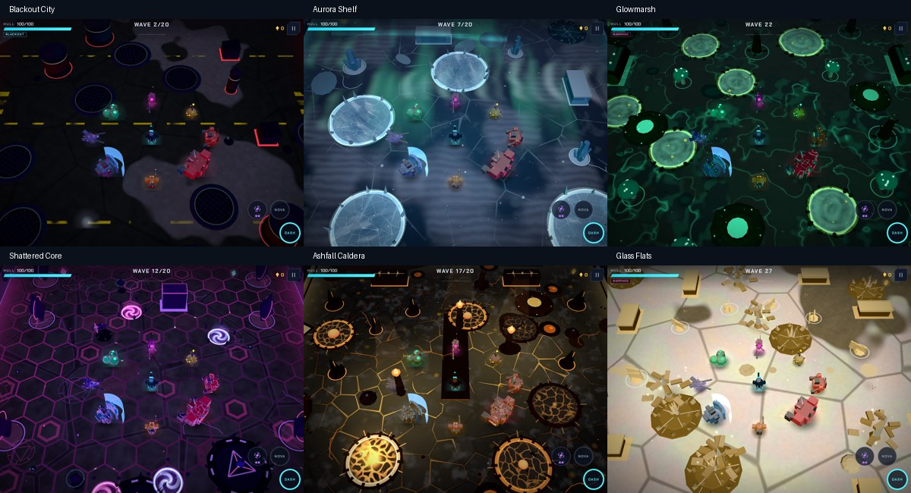
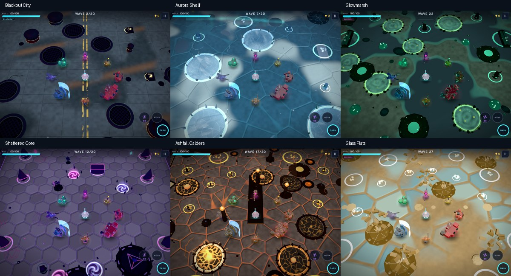
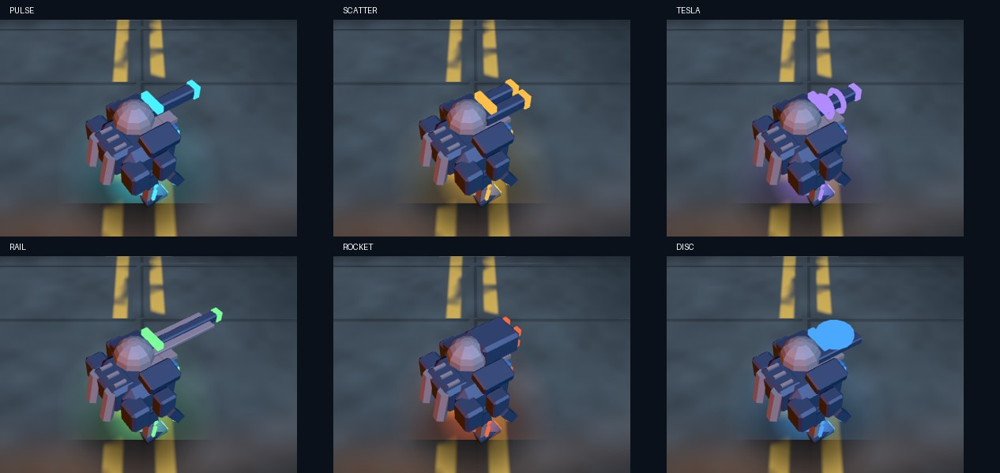

# Riftline 3.63 — surfaces, steel and impact

Base: `a9c2690` (merged 3.62.1 audit). Branch: `design/world-models-audio-3.63.0`.

## Direction and implementation plan

A tactile, stylized science-fiction world: quiet material surfaces, a recognizable armored walker,
sharp weapon feedback and compact, distinct sound gestures. Preserve landscape touch play and
readable red warnings. The renderer keeps instancing, bounded effects pools and one floor pass.

1. Replace the flat graphic floor patterns with material-specific relief and reflected light.
2. Shape the walker torso/shoulders and add planar chamfers to armor, machines, bosses and substantial props.
3. Give shots/hits/dashes a directional visual gesture; clear Nova's centre sooner.
4. Rebuild weapon transients and impact/ability layers, then verify actual samples and renderings.

All four implementation steps are present in this branch. This is a procedural art pass; the mesh
and shader sources are the authored assets. No external texture/model/audio licence is introduced.

## World materials

| Place | Treatment |
|---|---|
| Blackout City | Blue-grey aggregate asphalt, recessed tar joints, worn paint, dark oily reflections |
| Aurora Shelf | Deep blue ice, raised snow pockets, buried cold fissures and sharper ice sheen |
| Glowmarsh | Peat banks above ink-dark water, low ripples and restrained luminous shorelines |
| Shattered Core | Individually shaded hex slabs, planar bevels and deep violet gaps |
| Ashfall Caldera | Raised charcoal crust above recessed ember seams; warm directional light |
| Glass Flats | Ochre wind-rippled sand with cool glass fragments and sun highlights |

Height normals are reconstructed from screen derivatives of world-space relief. They are shading,
not collision displacement. The floor still uses one draw call, with existing event darkening,
muzzle/explosion lights and fog. Saver reduces microstructure and normal strength.

Before (3.62 artwork):

After:

These are staged fixed-seed tablet scenes, not naturally played fights. The older baseline uses
12 settling frames; the new captures use two, so atmosphere and layout rise animations differ.
The new High matrix covers all six biomes × encounter/boss/warnings, 18 screenshots with no
browser/shader errors. Observed range: 58–106 draw calls and 16,244–61,940 triangles in these fixtures.
This is a cloud software GPU measurement, not a phone FPS claim.

## Models and effects

The walker gains a chamfered torso, shoulder caps, backpack housings, chest plate and vents.
Weapon mounts retain distinct silhouettes. Armor chamfers use 44 triangles per box and stay within
the old bounds. Solid actors use Phong highlights; enemy instancing, skin overlays, hit flashes,
walk animation and boss articulation remain connected to the simulation.

Muzzle flashes now have a small white jet; ordinary hits produce short directional streaks and
criticals a larger fan. Dash draws two narrow trailing rails. Nova uses fewer, shorter-lived ions
with its existing expanding warning-coloured rings. Existing capped line/particle pools are reused.

## Sound

Pulse has a dry ignition and compact body, Scattergun a broadband crack and delayed mechanism,
Arc Caster a split electrical snap, Railgun a short metallic discharge, Rocket Pod an ignition and
rising motor, Disc Launcher an inharmonic metal sweep. Ember Jet keeps its continuous roar.
Hits, explosions, Dash and Nova also receive new transient/body layers. Lower sustained sub-bass
levels leave more useful midrange detail. Voice priorities, warning protection, ducking and volume
controls continue to govern the same engine; a few effects add a short-lived voice.

[Listen to the sound reel](design-3.63/sound-reel.mp3).

The audio reel's order is Pulse, Scattergun, Arc Caster, Railgun, Rocket Pod, Disc, Ember Jet,
hit, explosion, Dash, Nova. Each slot is 1.6 seconds. Preview playback is not a physical-speaker
acceptance test.

## Verification and acceptance

Geometry tests verify closed chamfers, outward normals, unchanged bounds and finite meshes for
all 25 enemies, seven weapon kits and all boss definitions. Standard game regressions still cover
save/update flows and touch play.

- `npm run check`: formatting/lint/build and 30/30 tests passed.
- `npm run verify:audio`: 361 sounds, 18 music renders, 36 budgets; no failures (205.3 s).
- Staged actual drawing: 18 tablet High scenes, 18 phone Saver scenes, three phone Auto scenes;
  no browser/shader errors, including phone boss-HUD placement assertions. These bounded captures
  use two settling frames, rather than the standard visual script's 12.
- All seven weapon models and a combined rail/critical-hit/Dash scene were also drawn for preview.
- The full optional `npm run test:render` result and latest-commit CI status are recorded in the PR.

Screenshots were inspected as contact sheets, with enlarged City, walker and ice-warning views.
Auto captures its initial settings; these checks do not establish sustained adaptation or mobile FPS.

Before merge, review the preview images and sound reel. Physical iPhone/iPad/Android acceptance
still needs crowded fights, warning visibility on bright surfaces, speaker/headphone balance,
background audio recovery and sustained GPU/thermal behavior. No automated pass can establish
subjective sound preference or sustained mobile FPS.
