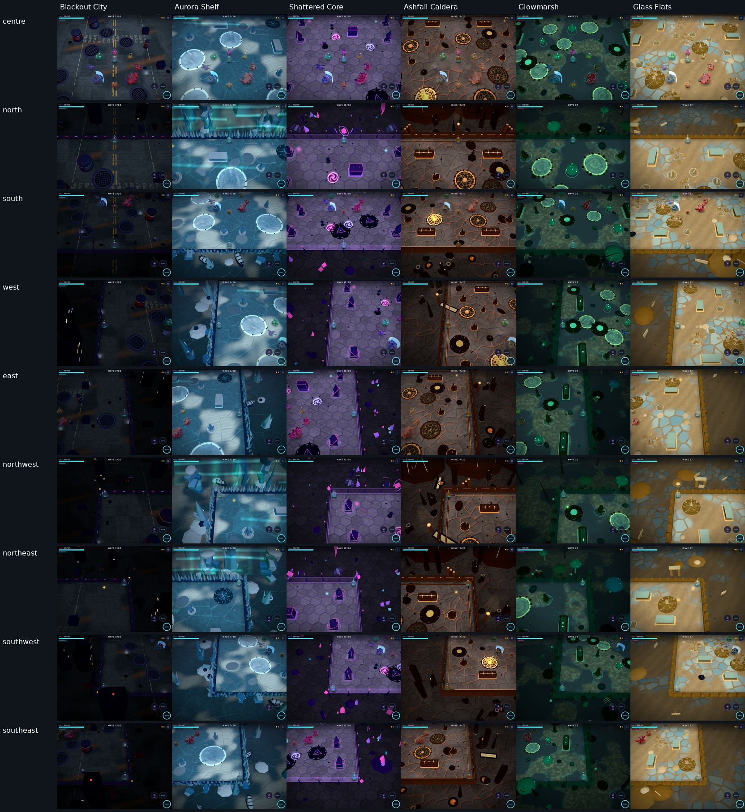
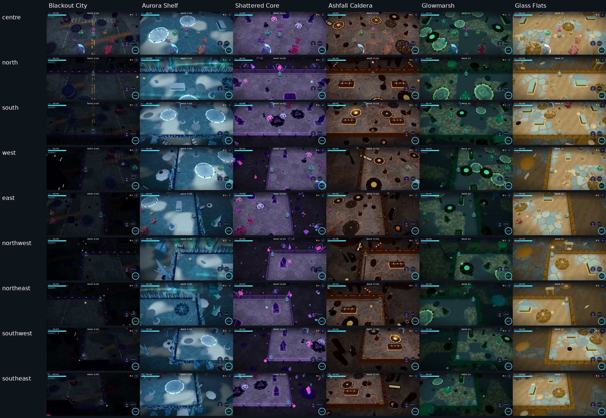

# 4.0 geometry follow-up

The first Caldera regression checked vertices for three seeds in an 18 × 18 half-size arena.
That was too narrow: triangle faces can cross the arena even when their vertices are outside, and other
biomes and small wave-director obstacles were not covered. This follow-up replaces that acceptance scope
with a complete scene-tree audit, including instanced and animated geometry.

## Findings and fixes

- Exterior prop anchors did not account for wide bases, leaned pieces or overhanging branches. Every grouped
  exterior prop now uses the union of its transformed body and glow bounds, and moves out as one unit until
  its entire bounds clear an arena edge by 0.35 m. This applies to the volcanoes as well as other biomes.
- City column caps exceeded their circular collision footprint. Their radius now matches the column.
- Marsh branches used a fixed one-metre length, including on generated circles as small as roughly 0.42 m.
  Branch length, thickness and offset now scale with the obstacle radius.
- The second Flats glass sheet used a fixed offset and could exceed smaller collision circles. Its offset
  now scales with the radius. Exterior dunes and Marsh mounds use complete-prop bounds too.
- Shelf crystal satellites also used fixed lengths on the smallest collision circles. Their lengths now scale with radius.
- Leaning Shelf spikes and Marsh reeds crossed their boundary slightly. Their rows move outward, including
  clearance for the reeds' GPU wind bending. Core corner crystals and the upper barrier trim move outward too.
- Small floating Core motes sit lower, leaving the upper combat space clear.

Saves, collision shapes, seeded layout choices and random draw order are unchanged. The shared material helpers
move to a browser-independent module so Node can construct the real ArenaView without booting the app or WebGL.

## Geometry checks

The normal `npm run check` gate includes 252 full map builds across all six biomes:

- Classic boss arenas.
- Seeds 1, 11, 42, 731, 65535 and 4294967295 at waves 2, 19, 32 and 67.
- All twelve wave-director modes in each biome.
- All four authored templates per biome, forced explicitly so the layout scorer cannot skip a template.
- Both 15 m and 20 m arena half-sizes.

The audit walks every scene mesh after batching, composes parent and instance transforms, validates finite
attributes and matrix values, and checks triangle indices. It clips whole triangle faces against the playable
arena volume. A synthetic regression specifically covers a face crossing the arena with all three vertices
outside. Another regression checks complete rotated exterior props beyond each of the four edges and a corner,
preserving the relative body/glow positions.

Spatial acceptance is explicit:

- Physical scenery above 0.8 m must not cross the arena boundary; the clipping tolerance is 1 mm.
- Ground dressing below 0.8 m is passable. Flat obstacle foot trim below 0.25 m is decorative.
- Solid obstacle faces above that trim must fit one convex collision footprint with at most 0.1 m of visual skin.
  This checks complete faces against boxes and circles, rather than accepting vertices from different obstacles.
- Animated meshes are checked at four yaw orientations and both bobbing extrema. Reed instances also receive
  all four extremal horizontal shader displacements before their instance/world transforms; the shader and audit
  share the wind amplitude constant.
- The existing actor-kit checks still validate all enemy, boss and weapon/player geometries and enemy budgets.
  This map audit does not establish watertightness for intentionally open meshes, all continuous animation poses,
  or the visual quality of every natural combat encounter.

## Visual acceptance

The visual tool now supports a map review mode. Each biome is captured from the centre, all four edges and
all four corners: 54 tablet High views and 54 landscape-phone Saver views with real drawing.

```sh
node tools/verify.js visual geometry-final tablet all high map
node tools/verify.js visual geometry-final land all battery map
```

The sheets below contain every captured view; open the image to inspect it at full size. Columns are biomes;
rows are centre, north, south, west, east, northwest, northeast, southwest and southeast.





[Caldera detail, nine tablet views](review-v4/caldera-geometry.jpg).

Local verification:

- `npm run check`: formatting, lint, build and **38/38 tests passed**, including the 252-layout audit (54.6 s).
- `npm run test:render`: **5/5 actual-drawing browser flows passed** (161.4 s) during the geometry follow-up.
- Final tablet High and phone Saver map matrices: **54 views each**, without browser/shader errors.
- [Tablet metrics](review-v4/geometry-tablet.csv) and [phone metrics](review-v4/geometry-phone.csv).

The full gate retains its 75-second test-process deadline. Browser drawing checks and staged matrices run
serially to limit resource contention. Physical-device testing and continuous-animation acceptance remain manual.


## GitHub run diagnosis

[Run 43046287472](https://github.com/Anton037/Riftline/actions/runs/43046287472) was cancelled during
`playwright install --with-deps chromium`. Its logs show DNS resolution failures for Ubuntu package mirrors,
and the five-minute job deadline expired during dependency installation. The `npm run check` step never ran.
Both browser workflows now pin Ubuntu 24.04 and install Playwright's pinned headless Chromium directly,
using the Chrome runtime libraries already supplied by the runner image. This avoids repeating apt/font
downloads; the browser tests still require the actual browser to launch successfully. The final PR check
result is reported separately; a cancelled installation run is not a passing test result.
