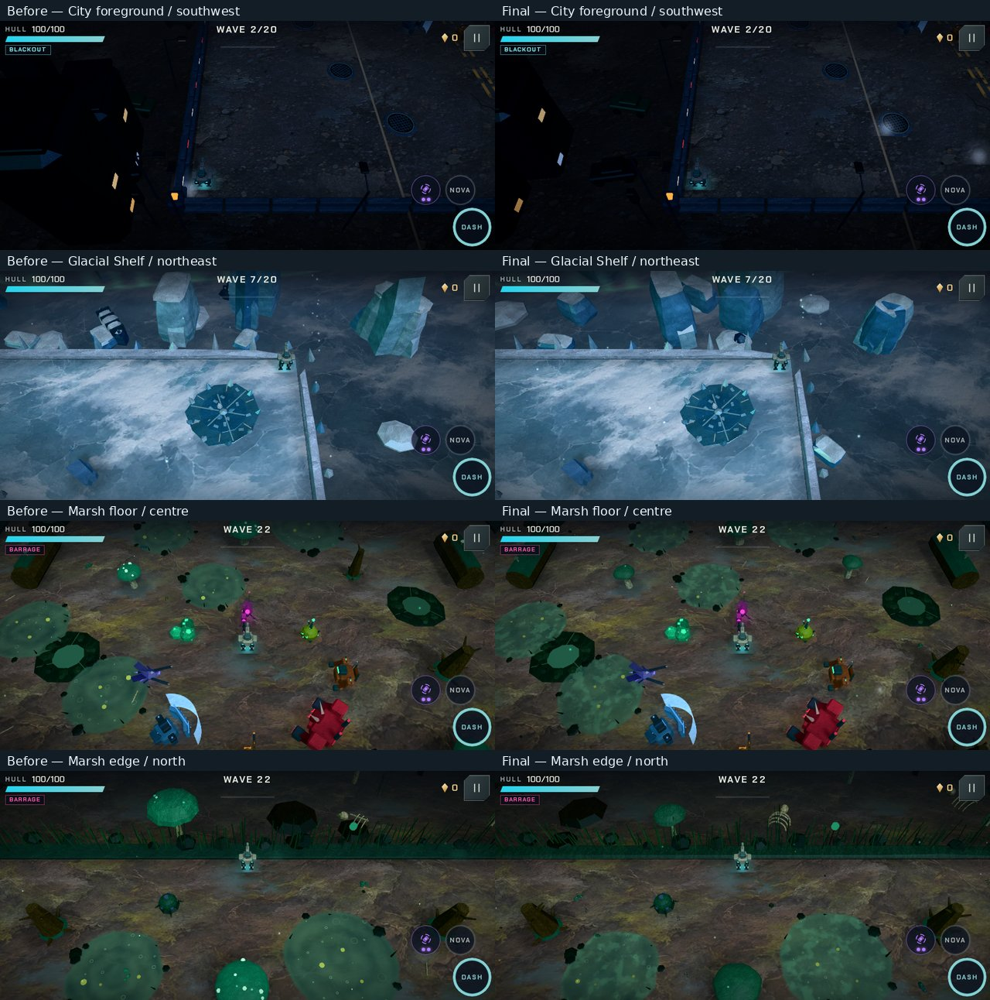
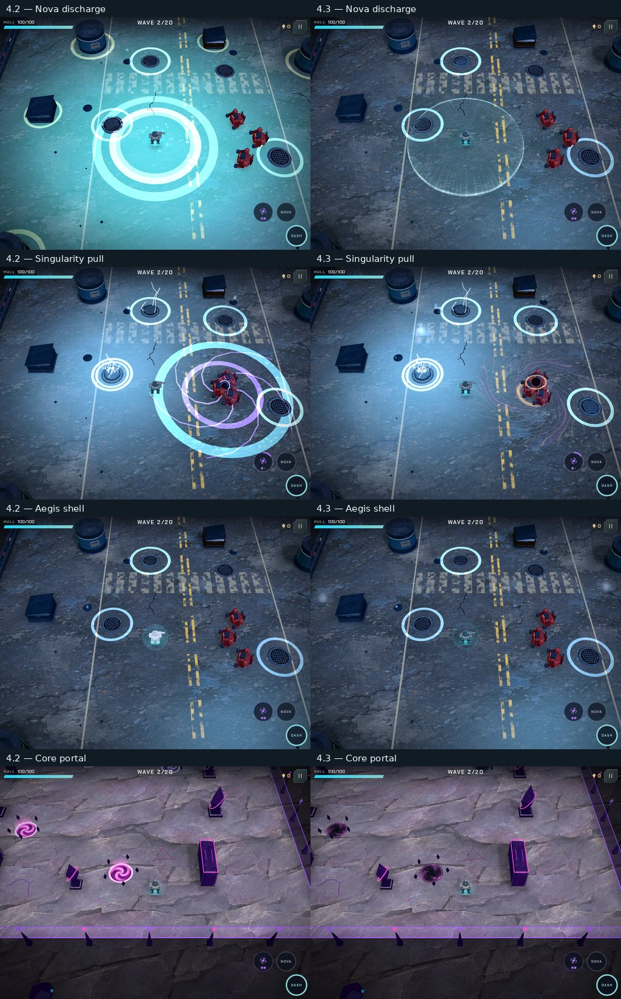
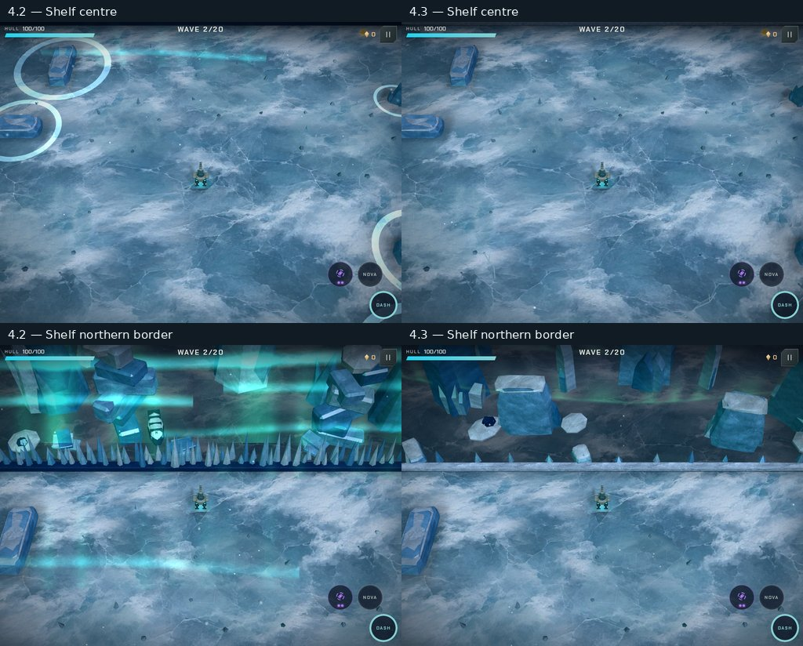

# Power effects and world scenery review — 4.3

## Applied improvement prompt

> Review the live game rather than assuming existing code or comments describe intended design.
> Make Nova read as a powerful expanding energy discharge and Singularity as a suspended gravitational
> core with orbiting matter, inward motion and a distinct collapse. Remove duplicate rings, opaque
> washes and temporary props that survive their purpose. Apply the same standard to Aegis, Event
> Collapse, Combo Surge and portals. Keep actors and hostile warnings readable. Rebuild the Shelf’s
> northern lights as natural distant, world-anchored ribbons with subtle ice reflections, never a
> foreground sheet over the play area. Preserve damage, timing, range, seeded layouts and save progress.
> Use bounded, separate effect resources so player powers cannot consume hostile-warning capacity.
> Inspect complete phases and multiple map positions on phone/tablet, and document concrete changes
> and measured costs. Make routine art and theme choices within this direction; ask before gameplay changes.

The owner selected natural distant aurora ribbons and subtle reflections.

## Findings

- A Shelf aurora plane was deliberately placed inside the arena and billboarded toward the camera.
  Other curtains were large flat cards; their apparent positions changed with the view.
- Nova is rendered by both its generic explosion event and its dedicated event, stacking floor rings
  and a screen-wide flash instead of showing a coherent wavefront.
- Singularity draws its spirals using the shared warning-beam pool and uses a spinning gadget model
  and multiple flat circles for its gravitational phase.
- Aegis, Event Collapse and Combo Surge rely on similarly generic translucent shapes/rings.

- Arena layout changes spawn large luminous rings around every obstacle, including in natural biomes.
- Core portals layer a bright flat swirl, rigid ring, glow column and billboard over the same opening.
- The Shelf skyline uses tall cones, floating stacks of slabs and a dense picket fence of ice spikes.

## Implemented

- **Nova:** one rising, curved pressure shell with an animated plasma edge and sparse ions. Its real
  `boom`/`nova` event pair now creates one wave and one discharge sound. The screen-wide flash is gone.
- **Singularity:** a small dark core follows the actual throw, rises above the ground during the pull,
  gathers matter through inward-moving filaments and a tilted accretion disk, then contracts into its
  collapse wave. The landing cue, pull radius and collapse radius follow simulation values.
  The old crossed-ring device, giant floor circles and 40 borrowed beam instances are removed.
- **Related powers:** Event Collapse builds a dark gravitational focus before Nova; Combo Surge retains
  its amber identity. Aegis has a clear centre, a Fresnel rim, panel seams and a short absorbed-hit ripple.
  Only the player's real `shieldBreak` event triggers this reaction; enemy Bulwark blocks and elite shield
  breaks keep their own effects. Changing worlds clears power transients before drawing the player.
- **Shelf:** three curved aurora ribbons share one world-anchored mesh beyond the north boundary.
  Slow rays and a green/violet falloff replace camera-facing cards; the ribbons appear naturally when
  the northern backdrop is visible. CPU culling bounds include shader sway. Exposed ice has a faint
  moving reflected tint, with no added texture or render pass. Shorter fractured seracs, connected
  calved cliffs, grounded low shelves and sparse border shards replace floating blocks and spike rows.
- **World clutter:** layout changes produce a few brief particles in the local material's colour,
  rather than neon obstacle halos. Real hazard warnings retain their timing and danger boundaries.
- **Core portals:** dark inward currents and a defined opening replace the bright swirl poster and
  redundant column/billboard/ring. Paired endpoint colours, rune stones and relocation warnings remain.
- **Sound:** separate physical profiles for Nova, Singularity launch, sustained pull and collapse.
  Nova uses one weighty transient; the pull uses a low sustained body and filtered air. The existing
  recorded material bank is reused, with no downloads or new assets.
- **Maintenance:** release/build identity, five-entry release notes, the roadmap and testing guide are
  updated. The optional bounded abilities check is available locally and through the manual workflow.

Damage, invulnerability, ranges, durations, collision, seeded layouts and saves are unchanged.
The Shelf's expedition hulls are replaced by natural pressure ridges and calved ice.

## Rendered review

These are live Three.js renders at High detail, with actual World events and simulation phases.
Contact sheets only resize and label captures; they do not retouch the game. The final scenery pass
is shown first; the power comparisons that follow document the initial effect pass (build r1).

The review includes Nova buildup/expansion/fade, Event Collapse before/after discharge, Combo Surge,
Singularity flight/pull/contraction/collapse/cleanup, Searing Collapse, Aegis and absorbed-hit decay,
paired Core portals, nine Shelf camera positions, and Nova/Singularity against every biome's floor.
[Phase contact sheet](review-4.3/power-phases.jpg), [phone biome comparisons](review-4.3/phone-biomes.jpg)
and [all nine phone Shelf views](review-4.3/phone-shelf-views.jpg) retain the rest of the review.
The same 37 scenes are checked on a 1024×768 tablet and an 844×390 landscape phone.

## Resource and correctness checks

- Player powers have three lazy, reusable pools: 32 waves, 32 field surfaces and 16 cores. At most three
  additional draw calls are needed, and empty pools are invisible. Transient waves are capped at 32.
- A stress contract draws 32 simultaneous waves and eight active Singularities without borrowing
  hostile-warning resources. GPU captures also measure the power draw's beam-pool delta each frame.
- The aurora is one draw call and 1,728 triangles, replacing six separately oriented cards. Shelf prop
  simplification offsets this geometry. No extra textures, lights or postprocessing passes are added.
- All seven player kits remain inside the existing 3,000-triangle budget, including Aegis. Their
  1,344 turn/aim/lean/recoil poses retain the physical weapon bearing and correct muzzle direction.
- The normal geometry audit checks transformed triangle faces across 252 maps, all director modes,
  authored templates, arena sizes and animation extrema. Its exterior-space and collision checks
  include the revised Shelf; a separate contract includes the aurora's maximum shader sway.
- Nova sound deduplication, actual Singularity phases, power cleanup, Aegis event identity and world
  changes have focused contracts. Existing deterministic layout/save/combat checks remain enabled.

Measured per-scene draw calls, triangles, particles and pool usage are retained in
[tablet metrics](review-4.3/abilities-tablet.json), [phone metrics](review-4.3/abilities-phone.json) and
[matched comparisons](review-4.3/comparison.json). Particle counts vary because presentation randomness
is deliberately separate from seeded gameplay. These counters do not establish physical-device FPS.

## Audio review evidence

[Listen to the power comparison](review-4.3/power-audio.mp3), with its
[clip timeline and measured levels](review-4.3/power-audio-timeline.json).
It compares the prior release and this change at the same volume and seed. Each version plays Nova's
actual two-event notification pair, followed by launch, pull and collapse. The old Nova dispatches
both `boom` and `nova`; the new dispatches only `nova`. No loudness normalisation is applied.

The standard check passed all 68 tests, including the 252-map audit; the final focused power/model
checks passed 17 tests. All 74 GPU scenes passed without browser/shader errors, power beam borrowing
or screen-wide flashes. Audio passed 439 sound renders, 18 music renders, 36 budget cases and fault
recovery. The full audio run took 329.8 seconds; its passing cache is retained for unchanged inputs.

In the initial build-r1 matched tablet scenes, the Shelf centre drops from 21,892 to 17,366 triangles and from 94 to 87
draw calls. Singularity releases all 40 formerly borrowed beam instances and drops from 103 to 101
draw calls. Nova changes from 98 to 99 calls for its curved shell, while its scene drops from 43,322
to 41,536 triangles. Particle counts are samples, not deterministic performance promises.

Final check results are recorded in [verification metadata](review-4.3/verification.json). Browser audio
checks establish finite output, levels, tails and allocator behaviour; device speakers/headphones and
physical phone/tablet pacing still need human play. No merge or deployment is performed by this review.

## Final scenery pass — build r2

The finish is judged by material coherence, grounded geometry, readable silhouettes, restrained decorative
glow and a clear play area. Routine art and theme choices follow that direction.

A fresh edge/corner review covered all six biomes on landscape phone (54 rendered views). It identified
foreground City towers crowding the play view, unrelated Shelf hulls, floating snow slabs, decorative
floor gems, basic hemispherical fungi and moss planks. The existing Core, Caldera and Flats treatments
were retained after the review.

- City buildings now use a height-dependent setback while the street furniture stays near the curb.
- The Shelf is entirely glacial: pressure ridges, calved blocks, broad fractured seracs, rooted frost and
  snow that follows the actual sculpted faces. Shipwrecks, lamps and decorative floor gems are removed.
- Marsh fungi use closed asymmetric caps with rolled edges and quiet gill light. Tiny floor fungi use
  cheaper geometry. Moss follows curved logs, and the peat bank has a sculpted contour.
- Marsh pools use patchy bloom and flowing ripples. Smaller bubbles rise before popping; subdued
  surface bubbles reduce the polka-dot appearance. Hazard ranges and boundary-ring behaviour remain.

[Matched scenery views](review-4.3/scenery-before-after.jpg) and the
[scenery measurements](review-4.3/scenery-metrics.json) record this pass. The power phase captures and
audio comparison above are from build r1; power logic, player models, weapons and audio are unchanged
in r2. Their passing checks are reused. The revised City, Shelf and Marsh are checked at all nine map
positions on both phone and tablet, with a fresh standard gate and the full 252-map geometry audit.

The geometry audit now uses conservative transformed bounds to reject scenery that is provably outside
the walkable volume, including maximum reed sway. Possible crossings still use complete triangle
clipping. A broad solid spanning the arena is checked explicitly to protect that distinction. The
75-second standard deadline is unchanged.

Final r2 results: 69 standard tests passed in 46.9 seconds, including all 252 map layouts and the
1,344 weapon attachment poses. The map audit took 14.5 seconds. All 54 final City/Shelf/Marsh views
(27 per device layout) passed with painted atlases and shadows enabled, without browser/shader errors.

In the matched phone centre view the Shelf drops from 26,204 to 23,903 triangles and 140 to 137 draw
calls. The Marsh retains 112 calls and increases from 61,270 to 62,834 triangles (about 2.6%) for the
sculpted fungi; tiny caps use 48 triangles and larger caps stay within 300. City draw calls remain 116.
These scene measurements include actors and weather; they are separate from the initial power captures.
