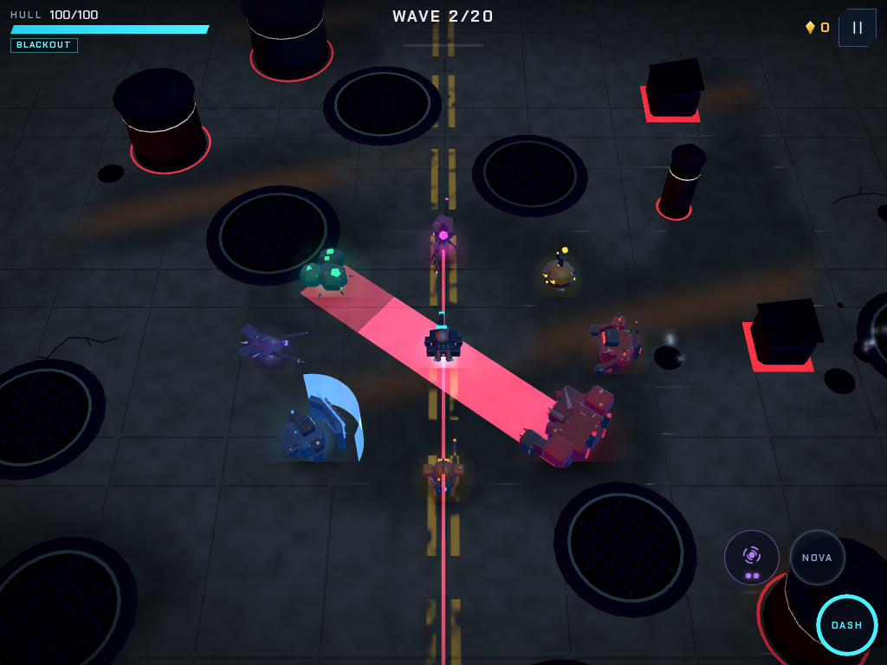
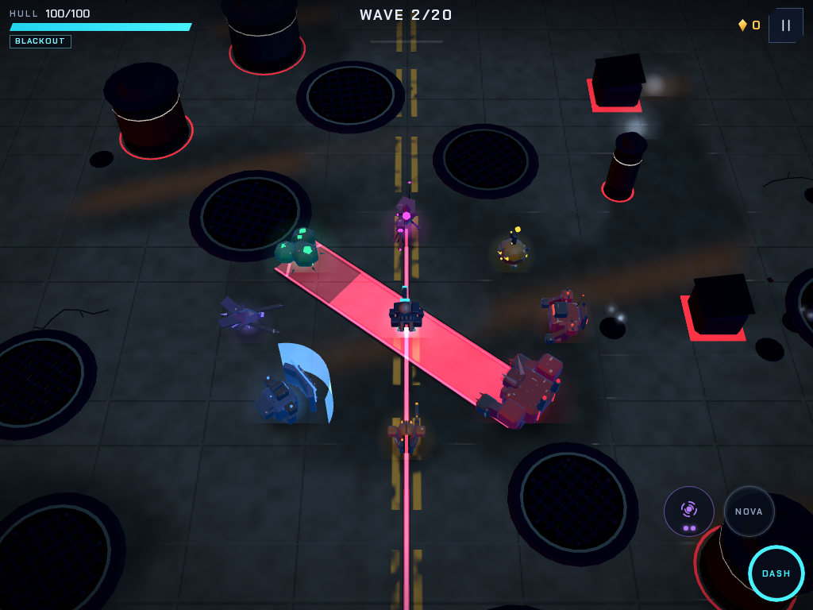
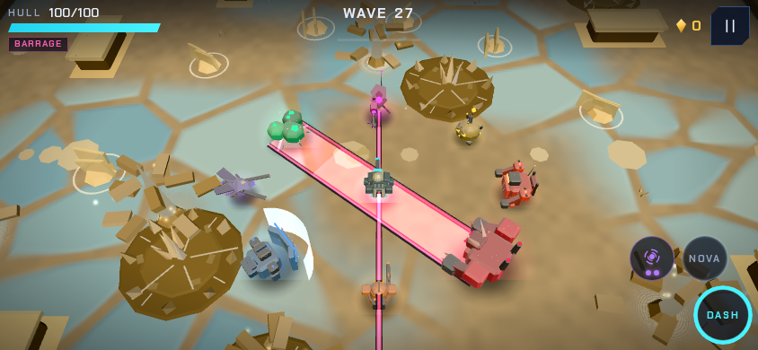

# Riftline review and applied improvement prompt — 3.64.0

Reviewed from `0fcbc25` (3.63.1), 11 November 2026. Prepared for review; this review does not merge or deploy the changes.

## Criteria and assessment

I assessed correctness and fairness, threat readability on bright/dark arenas, silhouettes at game scale,
sound cues under combat load, bounded rendering cost, deterministic coverage, and preservation of touch controls
and existing saves. The existing six-biome art direction, weapon/actor silhouettes, offline recovery and touch
flows are substantial strengths. This pass concentrates on trust in cover and readable incoming attacks.

| Finding | Evidence | Applied improvement |
|---|---|---|
| Rays can skip nearby/narrow cover | Original `rayLen` starts at 0.8 m and samples every 0.35 m. A thin box at x=1.025 returns 10 m instead of 1 m; a near circle at x=.45 returns 10 m instead of .35 m. Both new regressions fail before the fix. | Exact box/circle/arena-boundary intersections, without per-query allocations. Aim uses the same ray. |
| A gadget can land behind close cover | The minimum 1.5 m landing distance overrides a close wall. | Preserve the 0.4 m setback where possible; allow a close or zero-distance throw. |
| Beam collision can extend through cover | Even after clipping the centreline, the collision capsule's rounded endpoint can hit a player behind a thin wall. A second regression reproduced this at x=1.65. | Check line of sight when a beam would hit; skip fully blocked beams and their visual. |
| Charge/sniper warnings are inconsistent | Existing charge lanes are translucent fills; locked sniper aim flashes at 24 Hz. Existing beam/radial warnings have stronger steady edges. | Steady charge rails, dark keylines, direction chevrons and clamped countdown fill; steady wider/brighter sniper lock and a ground trace. |
| Sniper optics disappear at encounter scale | The long rifle silhouette works, but its narrow scope is difficult to distinguish. | Broader six-sided hood, pale upper plate and inset luminous lens, within the existing footprint. 472 → 508 triangles; still two instanced layers. |
| Several threat sounds can be stolen | Before/after saturation probes show charger, leaper, striker, driller and turret cues unprotected before, protected and retained afterward. | Derive priority from all mapped charge voices; protect turret servo. Retain existing warning ducking. Give the charger a relay click/faster motor onset and the leaper a midrange harmonic. |
| Visual verification wastes pixel submissions | Twelve rendered frames per staged scene, plus a running paused-game render loop. | Stop the loop after boot; advance the same twelve scene updates, submit only the final frame, and capture real pixels. Add a dedicated telegraph scene. |

## Improvement prompt, applied

> Preserve Riftline's touch-only landscape identity, saves and six-biome art direction. Fix exact ray/obstacle
> and arena-edge intersections without per-ray allocation. Keep gadget landings before nearby walls and
> zero-length beams finite, harmless and invisible; cover must also shield against rounded beam endpoints.
> Add regression cases that fail against the original behavior. Make charge and sniper telegraphs steady,
> directional and readable against both dark asphalt and bright ice/glass, using bounded instanced geometry.
> Improve sniper optics within the current silhouette and mobile geometry budget. Protect all mapped aim/charge
> sounds under voice pressure, and improve charger/leaper onset and midrange detail without globally increasing
> volume. Extend saturated-audio checks and enforce the existing 810-triangle enemy budget. Make the visual
> matrix settle without redundant WebGL submissions, retaining real final pixel rendering and metrics.
> Validate the normal gate, actual-drawing touch flows, six-biome scenes, phone Saver and changed audio cues.
> Record evidence and limits; do not merge or deploy.

## Visual and audio evidence

Matched City scenes below use the same staged enemy states, fixed layout, camera and quality. The old build
was saved before source edits and captured with the updated fixture. Decorative particles remain stochastic.

Before:

After:

Phone Saver, Glass Flats:

[Before/after sound reel](review-3.64/threat-cues-before-after.mp3): charger before, charger after, leaper before,
leaper after, separated by half-second gaps. Seeded offline renders use the same bus settings and no room reverb.
No loudness normalization is applied. Charger peak .0477 → .0389, RMS .003774 → .003775; leaper peak
.0550 → .0559, RMS .004794 → .003712. Both remain finite, audible and unclipped. These numbers establish
signal health, not subjective speaker quality; phone-speaker acceptance remains open.

A local 100,000-ray benchmark on the same four-obstacle layout measured 79.4 ms for the sampled implementation
and 13.4 ms for exact intersections. Distances differ intentionally. This is a narrow CPU query measurement,
not a whole-game FPS or mobile-performance claim. Warning keylines add one bounded 256-instance pool and at
most one draw call when present; sniper geometry adds 36 triangles with no extra actor draw call.

## Verification and limits

- Baseline normal gate: 32/32 tests passed.
- Final `npm run check`: formatting, lint, build and 34/34 tests passed (31.4 s test run), including the beam-endpoint guard.
- `npm run test:render`: 5/5 real-drawing touch/onboarding/training/worker flows passed (135.0 s).
- Tablet High: 24 scenes, all six biomes × encounter/boss/radial warnings/charge-and-sniper warnings, no browser/shader errors.
- Landscape phone Saver: the same 24 scenes, no browser/shader errors; boss HUD placement assertions passed.
- Audio scheduler: calm, boss and flooded cases match the real-node reference in all six biomes. Nine warning voices survive saturation both before and after the cue and duck the background.
- Five additional before/after offline cue renders are finite, audible and unclipped; all five previously unprotected cues now retain priority.
- One concurrent normal-gate attempt exceeded its existing 75 s deadline while multiple specialist probes were running. The isolated rerun passed; deadlines were not widened.

Environment: Chromium 156, SwiftShader; 1024 × 768 tablet High and 844 × 390 landscape phone Saver.

Reviewed rendered encounters from all six biomes, City/Shelf/boss/warning samples, and the changed telegraphs
on dark City, bright Shelf/Flats and phone Saver. Captures are staged; touch flows use emulation. This is not
an exhaustive attack-phase review, a full natural 20-wave run, long-session balance acceptance, a thermal/memory
soak or testing on physical iOS/Android devices. Those remain the next acceptance priorities in the roadmap.
