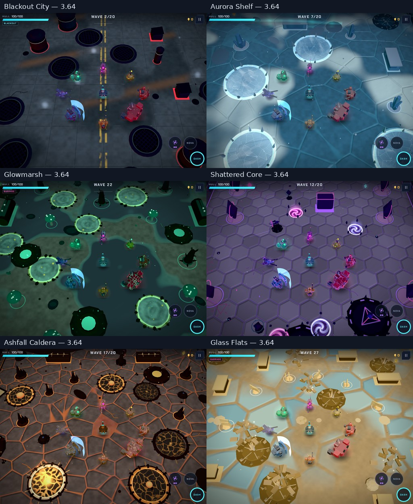
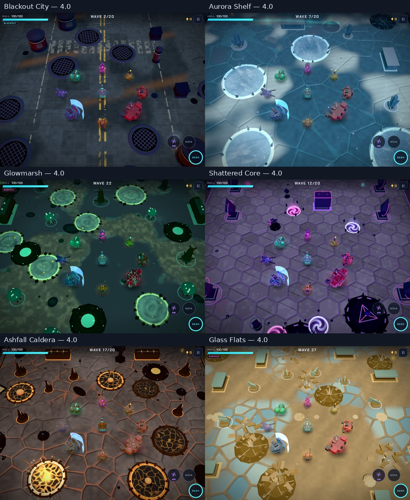
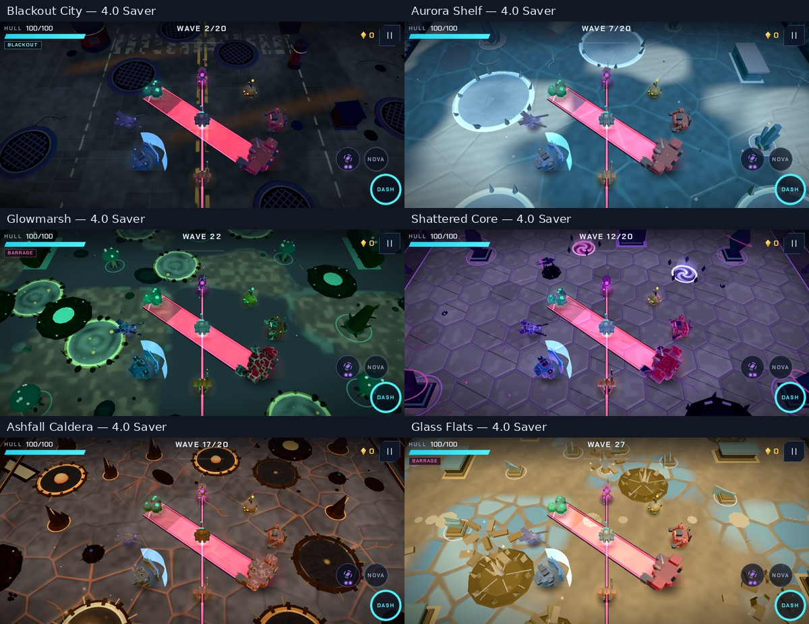
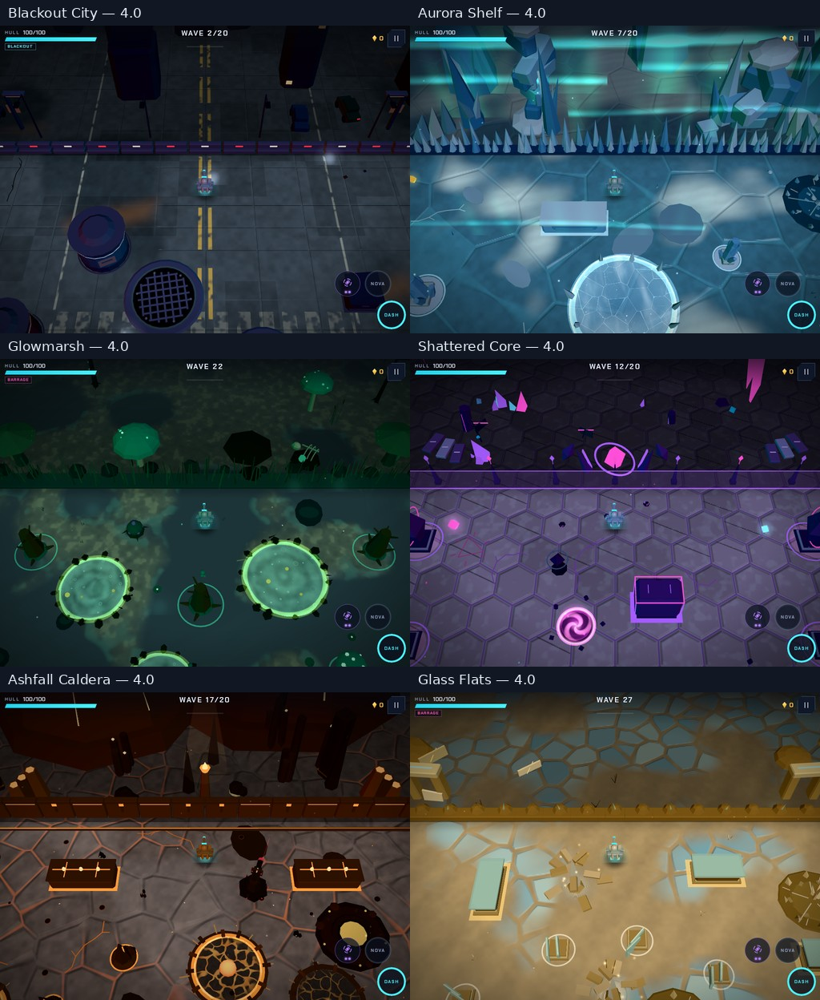

# V4 — six worlds, rebuilt

V4 follows the merged 3.64.0 cover, warning, model and audio work documented in [the initial review](REVIEW-3.64.md).
The visual goal is a coherent place for each biome, recognizable scenery at phone scale, and enough quiet
space around the walker to read combat. The changes are built into the map renderer and procedural materials.

| Biome | Map and material work |
|---|---|
| Blackout City | Worn crossings, road shoulders, asphalt repairs, weathered poster columns, reinforced dumpsters, readable iron manholes, concrete foundations and street lamps. Decorative alarm-red column rings become physical collars. |
| Aurora Shelf | Wind-shaped snow drifts and fine snow ridges over ice; low snow shelves within obstacle footprints and leaning ice formations beyond the wall. |
| Glowmarsh | Broken bioluminescent colonies replace continuous bright bank outlines; richer peat, readable wood, root foundations and tall glowcap landmarks. |
| Shattered Core | Fractured slab faces, restrained mineral dust, paired monolith crown plates, stepped foundations and broken suspended architecture. |
| Ashfall Caldera | Cooled ash-covered crust with localized molten seams instead of a continuous glowing cell grid; clearer basalt, layered rock foundations and basalt chimney landmarks. Large backdrop cones move beyond the playable edges. |
| Glass Flats | Smaller glass deposits surrounded by rippled sand, cooler glass obstacle faces and pale edges, layered sandstone foundations and eroded stone gateways. |

The walker gains lighter armor and pale shoulder plates so its shape separates from busy ground.
The previous steady charge/sniper warnings, revised scope, protected audio cues and exact cover checks remain
part of this release. Existing gameplay collision and save formats are preserved by this visual pass.

## Review criteria and applied improvement prompt

The 3.64 review concentrated on combat fairness. The next review looked at every biome as an environment:
material scale, quiet space around threats, solid obstacle readability, a distinct architectural vocabulary,
phone-size silhouettes, and the cost of the added detail. City cover was too dark, bright ground lines
competed with active hazards, and the Flats read as large tiled pools rather than glass scattered in sand.
The arenas also needed more physical detail and landmarks rather than another palette adjustment.

> Make 4.0 a substantial six-biome environment update. Preserve the touch controls, saves, seeded layouts and
> collision rules. Give the City worn street markings and believable street furniture, the Shelf wind-shaped
> snow and ice, the Marsh broken living banks and roots, the Core fractured architecture, the Caldera cooled
> layered rock with localized heat, and the Flats smaller glass deposits among sand and sandstone.
> Add recognizable physical map detail and distinct landmarks without introducing misleading cover or hiding
> the fight. Improve the walker silhouette at phone scale. Keep static detail batchable and avoid new textures,
> shadow passes or per-frame decoration work. Inspect real captures of all six worlds on tablet High and phone
> Saver, check combat warnings and bosses, and exercise the actual-drawing touch flows. Record costs and limits.

This prompt is implemented in the surface shader, biome props, new map architecture and walker model.
The new architecture is visual scenery; this update retains the existing generated arena routes and cover layout.

## Rendering constraints

New architecture is opaque static geometry, merged per material with the existing scene. Foundation details
stay within solid obstacle footprints; tall landmarks stay beyond the arena boundary. A geometry regression
checks narrow rectangular and circular footprints in all six biomes. There are no new shadow-map passes,
post-processing targets, texture downloads or per-frame landmark allocations. Saver retains the large shapes.

The full matrix stages encounters, bosses, radial warnings and charge/sniper warnings in each biome, on tablet
High and landscape-phone Saver. Visual acceptance includes looking at the resulting pixels; test success alone
does not establish art quality. Real drawing touch flows exercise movement, effects, pause/resume and transitions.
Physical-device heat, speaker quality and sustained frame pacing remain manual acceptance work.

## Geometry follow-up

A later [full geometry audit](GEOMETRY-AUDIT-4.0.md) broadens the original three-seed Caldera checks to
252 scene builds and all map edges/corners. It found additional small obstacle and boundary overhangs;
those are corrected in the updated PR. The combat comparison sheets and counts below record the initial
v4 visual snapshot; the linked geometry review records the final follow-up captures and checks.

## Initial verification

- `npm run check`: formatting, lint, build and **35/35 tests passed** (34.5 s test run).
- `npm run test:render`: **5/5 browser flows passed with real drawing** (163.0 s), covering tablet play,
  phone multitouch, first-run tutorial/audio/backgrounding, practice/save isolation and offline worker updates.
- Tablet High and landscape-phone Saver: **24 scenes each**, covering all six biomes and encounters, bosses,
  radial warnings and charge/sniper warnings. No browser/shader errors; phone boss HUD placement checks pass. After the Caldera backdrop fix, its eight tablet/phone scenes were recaptured; the other five biomes are unchanged.
- Six additional north-edge views expose the new architecture. The final Caldera edge view was recaptured after fixing the overhang.
- The new geometry regression checks narrow rectangular footprints, true radial bounds
  for circles, low foundations and landmarks beyond the arena wall in all six biomes. A reproduced Caldera backdrop-overhang regression fails before the cone placement fix and passes after it.

An initial normal-gate attempt hit the existing six-second training completion timeout. The isolated two-test
training run and final full gate passed; deadlines were not increased. Geometry checks caught overhangs from
rotated shelves and narrow basalt layers during implementation; the final geometry stays within those bounds.

## Visual evidence

The before/after sheets use the fixed encounter layout and enemy arrangement in the visual fixture.
Weather and decorative particles vary between captures. These are rendered game images; labels and sheet
assembly are the only image processing.

3.64 tablet High:

4.0 tablet High:

4.0 landscape phone Saver, with charge/sniper warnings:

4.0 north-edge views, showing the architecture beyond the arena walls:

## Rendering cost

The table below records the maximum submitted draw calls and triangles across the four staged tablet scenes
per biome, before (3.64) and after (4.0). Particle variation affects these counts slightly. This is rendering
work, not an FPS measurement. The added geometry has a cost; batching keeps it to a handful of extra calls.

| Biome | Maximum calls, before → after | Maximum triangles, before → after |
|---|---:|---:|
| Blackout City | 69 → 76 | 40,518 → 41,830 |
| Aurora Shelf | 89 → 92 | 26,446 → 27,130 |
| Glowmarsh | 86 → 92 | 58,872 → 61,636 |
| Shattered Core | 104 → 109 | 26,614 → 27,348 |
| Ashfall Caldera | 78 → 83 | 40,680 → 42,112 |
| Glass Flats | 96 → 101 | 27,030 → 27,874 |

Initial combat-scene metrics: [tablet High](review-v4/tablet-high.json), [phone Saver](review-v4/phone-saver.json).
Environment: Chromium 156/SwiftShader, 1024 × 768 tablet and 844 × 390 landscape phone, device scale factor 1.
The reviewed scenes cover every biome, staged bosses and warnings, and the added edge architecture. They do
not replace a natural twenty-wave playthrough, every boss attack phase or physical-device acceptance.
